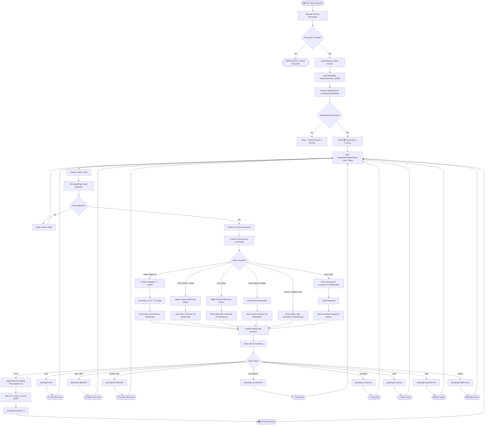

# 🖐️ Touchless Gesture Controlled Desktop Interaction Platform

> Control your entire desktop — mouse, keyboard, scroll, drag — using only **hand gestures** captured by your webcam. No physical hardware required.

---

## 📌 Table of Contents

- [Overview](#-overview)
- [How It Works](#-how-it-works)
- [System Architecture](#-system-architecture)
- [Full System Flowchart](#-full-system-flowchart)
- [Tech Stack](#-tech-stack)
- [Project Structure](#-project-structure)
- [Gesture Reference](#-gesture-reference)
- [Setup & Installation](#-setup--installation)
- [Running the App](#-running-the-app)
- [WebSocket Protocol](#-websocket-protocol)
- [Coordinate Mapping](#-coordinate-mapping)
- [Smoothing Algorithm](#-smoothing-algorithm)
- [Gesture Debouncing](#-gesture-debouncing)


---

## 🧠 Overview

The **Touchless Gesture Controlled Desktop Interaction Platform** is a full-stack, real-time system that lets you control your computer using only your **hand gestures** — captured entirely through a standard web browser and webcam.

The system is split into two parts:

| Layer | Technology | Responsibility |
|-------|-----------|----------------|
| **Frontend** | Next.js 14, TypeScript, MediaPipe | Webcam capture → Hand landmark detection → Gesture classification → WebSocket transmission |
| **Backend** | Python, FastAPI, PyAutoGUI | WebSocket listener → Command parsing → OS-level cursor & keyboard control |

The key insight is that **all computer vision runs in the browser** using WebAssembly — no Python ML libraries needed. The backend is a thin, fast, OS-automation layer.

---

## ⚙️ How It Works

The platform operates as a **continuous real-time pipeline** running at ~30 frames per second:

1. **Camera Capture** — The browser accesses the device webcam via `getUserMedia`.
2. **Hand Detection** — MediaPipe's `HandLandmarker` WASM model detects the hand and outputs 21 3D landmark points per frame.
3. **Gesture Classification** — Landmark geometry is analyzed to classify the current gesture (e.g., pinch = click, fist = right-click, index up = move cursor).
4. **Coordinate Normalization** — The index fingertip's (x, y) position is normalized to `[0.0, 1.0]` relative to the video frame.
5. **WebSocket Transmission** — The classified action + normalized coordinates are sent as a JSON payload over a persistent WebSocket connection to `ws://localhost:8000/ws`.
6. **Command Parsing** — The FastAPI backend receives and decodes the JSON command.
7. **EMA Smoothing** — Cursor coordinates are smoothed using an Exponential Moving Average filter to eliminate jitter.
8. **OS Interaction** — PyAutoGUI translates the smoothed coordinates to pixel positions and performs the corresponding OS action (move, click, scroll, type, hotkey).

---

## 🏗️ System Architecture

```
┌──────────────────────────────────────────────────────────────────┐
│                        BROWSER (Frontend)                        │
│                                                                  │
│  ┌──────────┐    ┌──────────────────┐    ┌───────────────────┐  │
│  │  Webcam  │───▶│  MediaPipe WASM  │───▶│ Gesture Classifier│  │
│  │ (video)  │    │  HandLandmarker  │    │ (21 landmarks)    │  │
│  └──────────┘    └──────────────────┘    └────────┬──────────┘  │
│                                                   │              │
│  ┌────────────────────────┐    ┌──────────────────▼──────────┐  │
│  │   Overlay UI (React)   │◀───│   Zustand Gesture Store     │  │
│  │  Status / Gesture HUD  │    │  (isConnected, isTracking)  │  │
│  └────────────────────────┘    └──────────────────┬──────────┘  │
│                                                   │              │
│                                         WebSocket │ JSON Command │
└──────────────────────────────────────────────────┼─────────────┘
                                                    │
                                    ws://localhost:8000/ws
                                                    │
┌──────────────────────────────────────────────────▼─────────────┐
│                        PYTHON (Backend)                          │
│                                                                  │
│  ┌─────────────────┐    ┌──────────────┐    ┌────────────────┐  │
│  │  FastAPI Server │───▶│  EMA Filter  │───▶│   PyAutoGUI    │  │
│  │  WebSocket /ws  │    │  (Smoothing) │    │  OS Automation │  │
│  └─────────────────┘    └──────────────┘    └────────────────┘  │
│                                                      │           │
│                                              ┌───────▼────────┐  │
│                                              │  Mouse/Keyboard │  │
│                                              │  OS Events      │  │
│                                              └────────────────┘  │
└──────────────────────────────────────────────────────────────────┘
```

---

## 🔀 Full System Flowchart



---

## 🛠️ Tech Stack

### Frontend
| Technology | Version | Purpose |
|------------|---------|---------|
| [Next.js](https://nextjs.org/) | 14.x | React framework, App Router |
| TypeScript | 5.x | Type-safe development |
| [MediaPipe](https://ai.google.dev/edge/mediapipe/solutions/vision/hand_landmarker) | Latest | Hand landmark detection (WASM) |
| [Zustand](https://zustand-demo.pmnd.rs/) | 4.x | Lightweight global state management |
| WebSocket API | Browser native | Real-time communication to backend |

### Backend
| Technology | Version | Purpose |
|------------|---------|---------|
| [FastAPI](https://fastapi.tiangolo.com/) | 0.115.0 | Async WebSocket server |
| [PyAutoGUI](https://pyautogui.readthedocs.io/) | 0.9.54 | Cross-platform OS automation |
| [Uvicorn](https://www.uvicorn.org/) | 0.30.6 | ASGI server |
| Python | 3.10+ | Runtime |

---

## 📁 Project Structure

```
Touchless-Gesture-Controlled-Desktop-Interaction-Platform/
│
├── 📂 backend/
│   ├── server.py            # FastAPI WebSocket server + PyAutoGUI actions
│   ├── smoothing.py         # EMA coordinate smoothing filter
│   ├── gesture_utils.py     # Gesture classification helpers (pinch, fist)
│   └── requirements.txt     # Python dependencies
│
├── 📂 frontend/
│   ├── 📂 public/
│   │   ├── 📂 models/
│   │   │   └── hand_landmarker.task   # MediaPipe model file
│   │   └── 📂 wasm/
│   │       ├── vision_wasm_internal.js   # MediaPipe WASM JS glue
│   │       └── vision_wasm_internal.wasm # MediaPipe WASM binary
│   │
│   └── 📂 src/
│       ├── 📂 app/
│       │   ├── layout.tsx    # Root layout
│       │   ├── page.tsx      # Main page entry
│       │   └── globals.css   # Global styles
│       │
│       ├── 📂 components/
│       │   ├── HandTracker.tsx  # Camera + MediaPipe + WebSocket logic
│       │   └── Overlay.tsx      # HUD showing connection & gesture status
│       │
│       ├── 📂 store/
│       │   └── useGestureStore.ts  # Zustand store (connection, tracking, gesture)
│       │
│       └── 📂 utils/
│           └── debounce.ts   # Gesture debounce to prevent repeated triggers
│
├── 📂 docs/
│   └── ARCHITECTURE.md      # Detailed architecture notes
│
├── CHANGELOG.md             # Version history
├── PROJECT_EXPLAINED.md     # Plain-language project explanation
├── package.json             # Root workspace config
└── README.md                # This file
```

---

## 🤌 Gesture Reference

| Gesture | Description | Action |
|---------|-------------|--------|
| ☝️ **Index Finger Up** | Only index finger extended, rest curled | Move cursor |
| 🤏 **Pinch** | Thumb tip touches index fingertip | Left click |
| ✊ **Fist** | All fingers curled toward palm | Right click |
| 🤏 **Thumb + Middle Pinch** | Thumb tip touches middle fingertip | Double click |
| ✌️ **Two Fingers (V)** | Index + middle extended, move up/down | Scroll |
| 🤚 **Palm Hold** | Open palm held in place | Mouse down (drag start) |
| ✋ **Palm Release** | Open palm released | Mouse up (drag end) |

> **Tip:** Gestures use a 400ms debounce window — hold a gesture clearly for at least half a second to ensure it registers reliably.

---

## 🚀 Setup & Installation

### Prerequisites
- **Python** 3.10 or higher
- **Node.js** 18 or higher
- A device with a **webcam**
- A modern **Chromium-based browser** (Chrome, Edge)

### 1. Clone the Repository
```bash
git clone https://github.com/ASHUTOSHNIMBALKAR/Touchless-Gesture-Controlled-Desktop-Interaction-Platform.git
cd Touchless-Gesture-Controlled-Desktop-Interaction-Platform
```

### 2. Install Backend Dependencies
```bash
pip install -r backend/requirements.txt
```

This installs:
- `fastapi` — async web framework
- `uvicorn` — ASGI server to run FastAPI
- `pyautogui` — cross-platform GUI automation
- `websockets` — WebSocket support
- `pydantic` — data validation

### 3. Install Frontend Dependencies
```bash
cd frontend
npm install
```

---

## ▶️ Running the App

You need **two terminals** running simultaneously.

### Terminal 1 — Start the Backend
```bash
python backend/server.py
```
The FastAPI server starts at `http://127.0.0.1:8000`.  
WebSocket endpoint: `ws://127.0.0.1:8000/ws`  
Health check: `http://127.0.0.1:8000/health`

Expected output:
```
INFO:     Started server process
INFO:     Waiting for application startup.
INFO:     Application startup complete.
INFO:     Uvicorn running on http://127.0.0.1:8000
```

### Terminal 2 — Start the Frontend
```bash
cd frontend
npm run dev
```
Open your browser at **[http://localhost:3000](http://localhost:3000)**

> ⚠️ **Important**: Grant camera access when the browser prompts. The HUD overlay will show `🟢 Connected` when the WebSocket link to the backend is established.

---

## 📡 WebSocket Protocol

All communication between frontend and backend is plain **JSON over WebSocket**.

### Message Format
```json
{
  "action": "<action_name>",
  "x": 0.512,
  "y": 0.348
}
```

### Supported Actions

| `action` | Extra Fields | Description |
|----------|-------------|-------------|
| `move` | `x`, `y` (float 0–1) | Move cursor to normalized screen position |
| `click` | — | Perform a left mouse click |
| `right_click` | — | Perform a right mouse click |
| `double_click` | — | Perform a double left click |
| `mousedown` | — | Press and hold mouse button (drag start) |
| `mouseup` | — | Release mouse button (drag end) |
| `scroll` | `amount` (int, ±) | Scroll page; positive = up, negative = down |
| `type` | `text` (string) | Type a string of characters |
| `hotkey` | `keys` (string[]) | Fire a keyboard hotkey e.g. `["ctrl","c"]` |

### Example Payloads
```json
// Move cursor to 51.2% from left, 34.8% from top
{ "action": "move", "x": 0.512, "y": 0.348 }

// Left click
{ "action": "click" }

// Scroll up 3 units
{ "action": "scroll", "amount": 3 }

// Press Ctrl+C
{ "action": "hotkey", "keys": ["ctrl", "c"] }

// Type text
{ "action": "type", "text": "Hello World" }
```

---

## 📐 Coordinate Mapping

MediaPipe landmarks are **normalized** — `x` and `y` are always in `[0.0, 1.0]` relative to the video frame dimensions.

The backend maps these to absolute screen pixels:

```
target_x = clamp(x, 0.0, 1.0) × screen_width
target_y = clamp(y, 0.0, 1.0) × screen_height
```

Clamping ensures the cursor never exceeds screen boundaries, preventing PyAutoGUI's fail-safe triggers.

---

## 📈 Smoothing Algorithm

Raw hand tracking coordinates jitter frame-to-frame due to:
- Minor hand tremors
- Detection noise
- Lighting variation

The backend applies an **Exponential Moving Average (EMA)** filter:

```
x_smooth = α × x_raw + (1 − α) × x_prev
y_smooth = α × y_raw + (1 − α) × y_prev
```

Where **α = 0.35** (tunable). Lower α = smoother but laggier; higher α = more responsive but jittery.

| α Value | Behavior |
|---------|---------|
| `0.1` | Very smooth, noticeable lag |
| `0.35` | **Default** — balanced smoothness & responsiveness |
| `0.7` | Near-raw, very responsive, slight jitter |
| `1.0` | No smoothing (raw input) |

---

## ⏱️ Gesture Debouncing

Without debouncing, a held gesture like "pinch" would fire hundreds of clicks per second.

The frontend applies a **cooldown-based debounce**:

```
if gesture ≠ last_gesture  OR  time_since_last > 400ms:
    fire_gesture()
    update last_gesture + timestamp
```

This ensures each distinct gesture fires **at most once per 400ms**, making interaction feel natural and deliberate.

---

## 📄 License

This project is open source. Feel free to fork, contribute, and build on top of it.

---

<div align="center">

**Built with ❤️ using Next.js · MediaPipe · FastAPI · PyAutoGUI**

*No mouse. No keyboard. Just your hands.*

</div>
