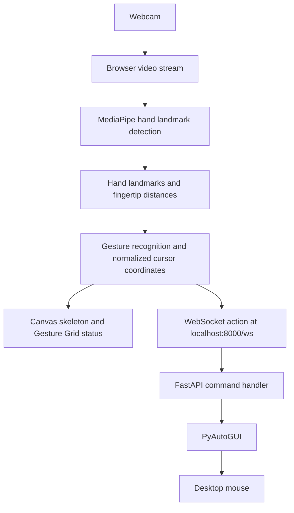

# Touchless Gesture-Controlled Desktop Interaction Platform

A webcam-based desktop interaction prototype that translates hand gestures into mouse movement, clicks, dragging, and scrolling. Hand tracking and gesture recognition run in the browser; a local FastAPI service receives the resulting commands over WebSocket and forwards supported actions to the operating system through PyAutoGUI.

> **Safety:** This application can control your real mouse. The backend currently sets `pyautogui.FAILSAFE = False`, disabling PyAutoGUI's corner fail-safe. Run it only on a trusted local machine, keep the backend bound to localhost, and be prepared to stop the backend process if input becomes difficult to control.

## Features

- Real-time single-hand landmark detection using MediaPipe Tasks Vision.
- Browser webcam preview with a drawn hand skeleton and highlighted index fingertip.
- Index-finger cursor control with a mirrored horizontal coordinate.
- Thumb-index pinch for left-button press/drag and release when the hand opens.
- Thumb-middle pinch for continuous scroll mode.
- Thumb-ring pinch for a right click.
- Connection and current-gesture indicators in the Gesture Grid overlay.
- Local WebSocket transport between the browser and the desktop-control service.

## Architecture



### Runtime flow

1. The frontend asks for camera permission and loads the bundled MediaPipe model and local WASM assets.
2. Each video frame is processed in the browser. MediaPipe returns normalized hand landmarks; the index fingertip determines the cursor position.
3. The frontend compares thumb-tip distances to the index, middle, and ring fingertips against a pinch threshold of `0.05` and selects the corresponding gesture.
4. The frontend sends an action and, when needed, normalized coordinates over `ws://localhost:8000/ws`.
5. FastAPI clamps cursor coordinates to the range 0–1, converts them to screen pixels, and calls the matching PyAutoGUI operation.
6. Zustand stores the visible connection and gesture state for the overlay.

Camera frames and hand landmarks are processed in the browser; the WebSocket sends control actions and coordinates to the local backend, not the video stream.

## Gesture controls

| Gesture | Result |
| --- | --- |
| Move index fingertip with no pinch | Move the cursor |
| Pinch thumb and index finger | Press and hold the left mouse button; continue moving to drag |
| Release the thumb-index pinch / open the hand | Release the left mouse button |
| Pinch thumb and middle finger | Scroll according to the index fingertip's vertical position relative to the frame center |
| Pinch thumb and ring finger | Right-click once when the gesture begins |

The middle-finger scroll mode takes priority over the ring-finger and index-finger pinches. Gesture detection uses a fixed image-space distance threshold, so lighting, camera placement, and hand distance may affect recognition.

## Technology

- **Frontend:** Next.js, React, TypeScript, MediaPipe Tasks Vision, Zustand.
- **Backend:** Python, FastAPI, WebSockets, Uvicorn, PyAutoGUI.
- **Bundled inference assets:** `frontend/public/models/hand_landmarker.task` and `frontend/public/wasm/`.

## Requirements

- Windows 10/11 (the commands below use PowerShell); PyAutoGUI supports other desktop platforms, but platform-specific setup may differ.
- Node.js 20.9 or later and npm.
- Python 3.10 or later with pip.
- A webcam and a browser that supports camera access and the MediaPipe GPU delegate.

## Setup (Windows PowerShell)

Run these commands from the repository root:

```powershell
npm install
npm ci --prefix frontend
py -m venv .venv
.\.venv\Scripts\python.exe -m pip install -r backend\requirements.txt
```

If the `py` launcher is unavailable, create the virtual environment with your installed Python executable instead. If PowerShell blocks activation scripts, the commands here do not require activating the environment because they call its Python executable directly.

## Run

Start the backend in one PowerShell terminal from the repository root:

```powershell
.\.venv\Scripts\python.exe backend\server.py
```

Start the frontend in a second terminal:

```powershell
npm run dev:frontend
```

Open [http://localhost:3000](http://localhost:3000), allow camera access, and wait for the backend connection indicator to show **ONLINE**. The backend listens on `127.0.0.1:8000`; the frontend currently connects to `ws://localhost:8000/ws`.

The root `npm run dev` script starts both services concurrently. Use it after completing the setup above if you prefer a single command:

```powershell
npm run dev
```

Stop the services with `Ctrl+C` in their terminal. If the mouse is moving unexpectedly, stop the Python backend immediately.

## Repository layout

```text
.
├── backend/
│   ├── requirements.txt       # Python dependencies
│   └── server.py              # WebSocket-to-desktop command bridge
├── frontend/
│   ├── public/
│   │   ├── models/            # MediaPipe hand landmark model
│   │   └── wasm/              # Local MediaPipe runtime assets
│   └── src/
│       ├── app/               # Next.js page, layout, and styling
│       ├── components/        # HandTracker and status overlay
│       └── store/             # Zustand gesture and connection state
├── package.json               # Root scripts and concurrently dependency
└── README.md
```

## Safety and privacy

- The backend is intended for local use and binds to `127.0.0.1`. Do not change it to listen on a public interface or expose it through a tunnel: the WebSocket endpoint has no authentication and can trigger operating-system input.
- The backend currently disables PyAutoGUI's emergency corner fail-safe (`pyautogui.FAILSAFE = False`). Treat this as a known safety limitation; terminate the backend process to regain control if needed.
- The browser requests webcam permission. The current implementation processes the video locally and does not transmit camera frames to the backend.
- Only use the software on a device you own or are authorized to control. Review the backend actions before connecting any other client.

## Troubleshooting

- **Camera does not start:** Check browser camera permissions, ensure another app is not exclusively using the camera, and open the site on `localhost`.
- **Status shows offline:** Start the Python backend and check that port `8000` is available.
- **Model or WASM loading errors:** Confirm the model and WASM assets are present under `frontend/public/` and inspect the browser console.
- **Mouse actions are unreliable:** Improve lighting, keep one hand clearly visible, and adjust camera distance. The pinch threshold is currently hard-coded in `frontend/src/components/HandTracker.tsx`.
- **Python dependency installation fails:** Use a supported Python installation and consult the platform-specific installation notes for PyAutoGUI.


## Commit history

Commit dates and history should reflect actual development. This repository does not include artificially backdated commits; future work should be recorded as changes are made.
